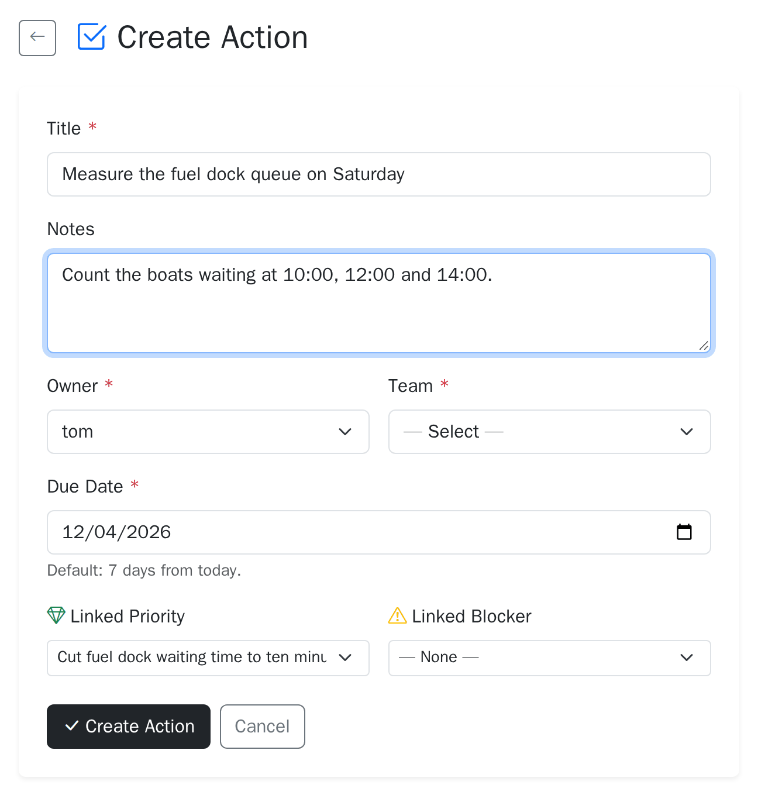

# Screenshots

Nobody takes these screenshots by hand. A script signs in to a throwaway copy of Empresadence, does the tasks the guides describe, and saves a picture at each step. When the interface changes, run the script again and every picture is up to date.

## The rules

- **Use only the Harbour Lights demo data.** Harbour Lights is a made-up harbour business. Its people are made up and their email addresses end in `example.com`. Never show a real company, a real person or real data.
- **Do not edit a screenshot by hand.** If a picture is wrong, change the script and run it again.
- **Show the step, not the whole page.** Crop to the part the reader needs.
- **Keep files small.** Aim for under 200 KB each.

## The files

| File | What it is |
|---|---|
| `docs/_tools/seed_demo.py` | Creates the Harbour Lights organisation, its people and its records |
| `docs/_tools/capture_screenshots.py` | Signs in, walks through the tasks and saves the pictures |
| `docs/_tools/screenshots.json` | The manifest. For each picture: its file name, the address it was taken at, who was signed in, and what it shows |
| `docs/_tools/check_images.py` | Checks that every picture a page uses exists, has alt text and is in the manifest, and that no picture is unused |
| `docs/_static/screenshots/` | The pictures, as PNG files |

## How a picture is taken

- The browser window is 1280 pixels wide, in the light theme.
- Pictures are captured at twice the pixel density, so they stay sharp on modern screens. The docs show each one at half its pixel width.
- Each picture is cropped to named parts of the page, such as one card or one form.
- Each PNG is reduced to at most 256 colours. For a flat interface this loses nothing you can see and makes the file much smaller.

## Regenerate every screenshot

The script changes data as it goes. Always start from an empty database.

`docs/README.md` has the full commands. In outline:

1. Start a throwaway PostgreSQL container and a throwaway copy of the app.
2. Load the demo data with `seed_demo.py`.
3. Run `capture_screenshots.py` in the official Playwright container.
4. Run `check_images.py`.
5. Remove the throwaway containers.

Dates in the demo data are worked out from today, so pictures always show the current quarter. This means every picture changes a little each time you regenerate them.

## Add a screenshot

1. In `capture_screenshots.py`, find the part of the `run` function that covers your task, or add one.

2. Add a call to `cap.shot`. Give it a file name, one sentence on what the picture shows, and the parts of the page to crop to.

   ```python
   cap.shot(tom, 'action-form', 'The Create Action form, filled in', 'main .card', 'main h1')
   ```

3. Regenerate the screenshots.

4. Use the picture in your page, directly under the step it shows, with alt text.

   ```markdown
   
   ```

5. Run `check_images.py`.

## What happens next

Commit the pictures, the script and `screenshots.json` together, so the manifest always matches the pictures.
