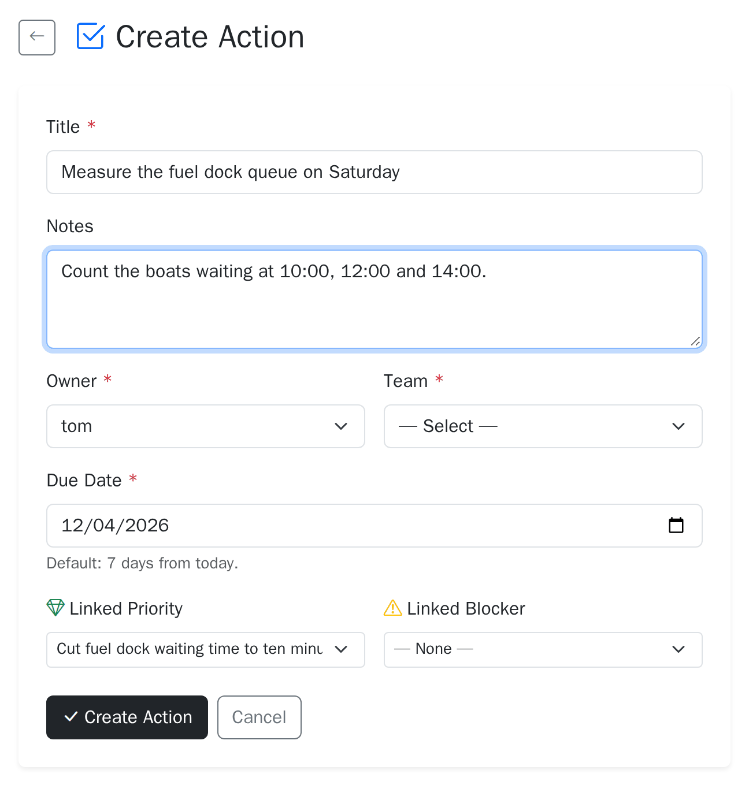
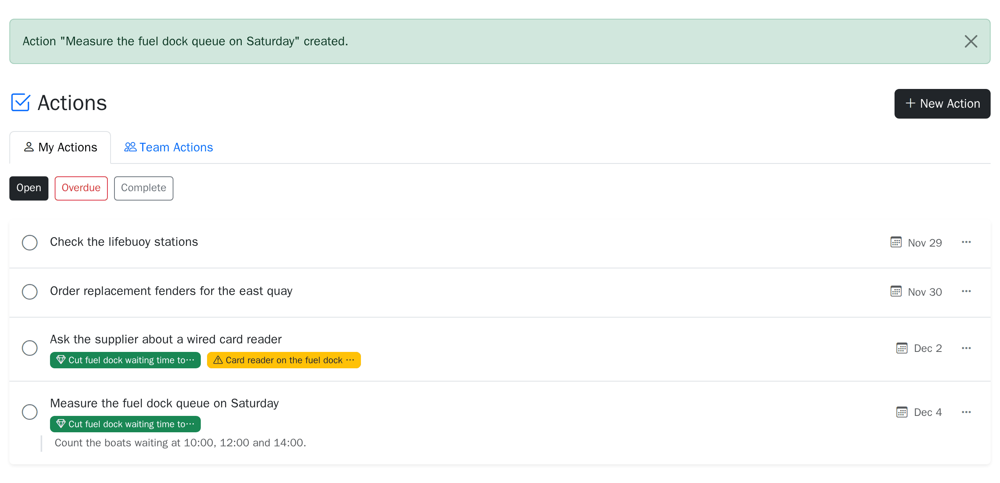
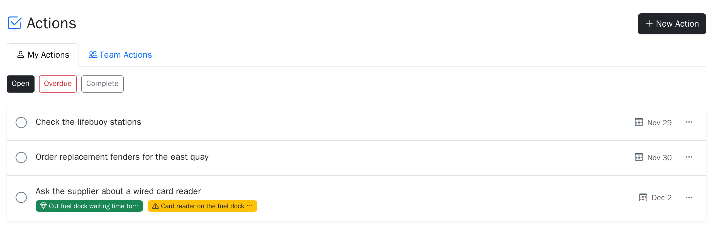
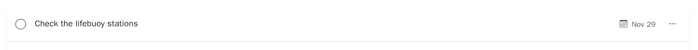
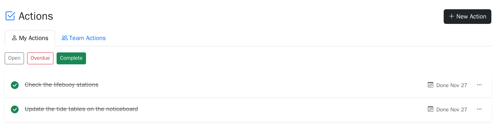

# Add and complete an Action

An Action is a small task for one person to finish within about a week.

Your organisation may have renamed some words. This page uses the default names. See the [glossary](../reference/glossary.md).

## Before you start

- **Role needed:** any. You must belong to at least one team.
- The navigation bar must show the team the Action is for. To change it, select the team name and choose another team.

## Add an Action

1. In the navigation bar, select **Actions**, then **New Action**. The address is `/todos/new/`.

   You see the **Create Action** form.

2. In **Title**, type what needs doing.

3. Optional: in **Notes**, add any detail.

4. In **Owner**, choose the person who is to do it. The list shows the usernames of people in the team. It starts on you.

5. Leave **Team** empty. The Action is saved to the team named in the navigation bar.

6. Check the **Due Date**. It starts at 7 days from today. It cannot be in the past.

7. Optional: choose a **Linked Priority** or a **Linked Blocker** if the Action helps with one.

   

8. Select **Create Action**.

   You see the **Actions** page at `/todos/`. A green message confirms the Action was created.

   

## Find an Action

Open **Actions**, then **My Actions**. The page has two tabs and three filters.

| Control | What it shows |
|---|---|
| **My Actions** tab | Actions you own in the current team |
| **Team Actions** tab | Actions owned by anyone in the current team |
| **Open** | Actions that are not complete |
| **Overdue** | Open Actions whose due date has passed |
| **Complete** | Completed Actions, newest first |

## Complete an Action

1. Find the Action in the list.

2. Select the circle to the left of its title.

   

   The Action leaves the **Open** list.

3. To check, select **Complete**.

   You see the Action with a green tick, its title struck through, and the day it was done.

   

To reopen an Action, select its green tick.

## Change or delete an Action

1. Select the three dots at the right of the Action.
2. Select **Edit** to change it, or **Delete** to remove it.

## What happens next

- An open Action appears in the **Action Review** part of your team's next Weekly Meeting.
- An Action that has been open for 8 days or more shows a label with the number of days.
- After 14 days the label says to escalate. The three-dot menu then offers **Escalate to Blocker**, which creates a Blocker from the Action. This option does not appear if the Action is already linked to a Blocker.
- If the person who hosts your Empresadence has set up daily emails, each owner gets one email a day listing their overdue Actions.
