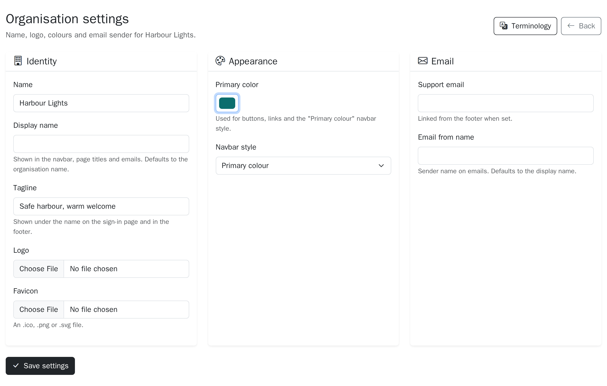
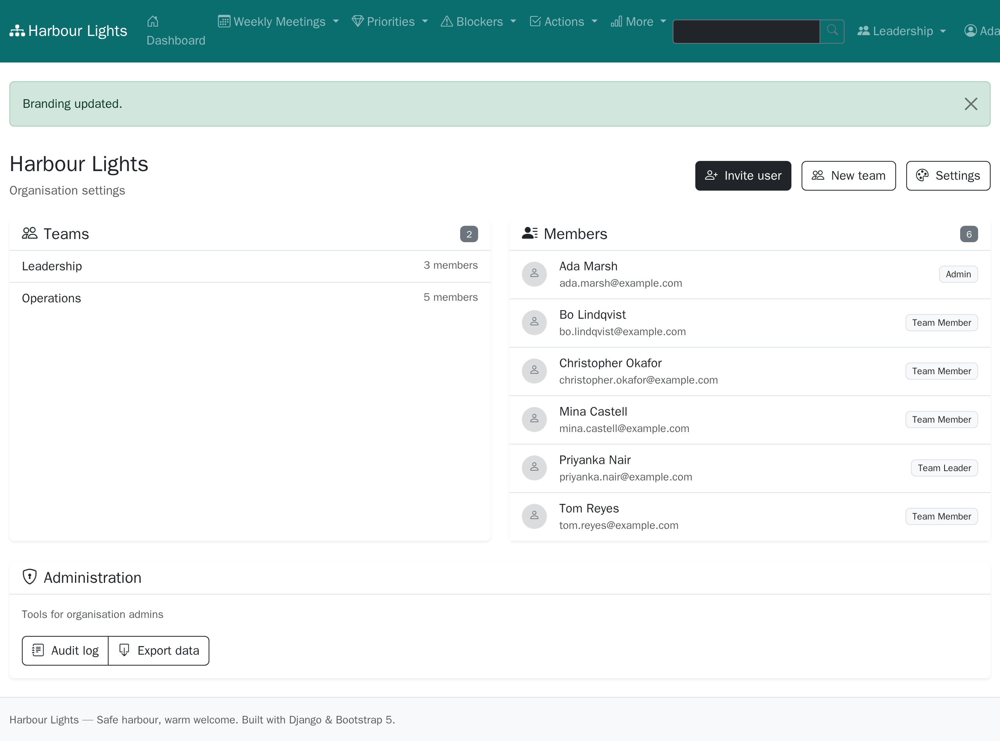

# Change your organisation's name, logo and colours

You can make Empresadence look like part of your organisation. The changes apply to everyone in your organisation.

## Before you start

- **Role needed:** Admin.
- Have your logo ready as an image file, if you want one.

## Change the settings

1. Select your name at the top right of the page, then **Organisation settings**. The address is `/org/settings/`.

   You see a form with three groups: **Identity**, **Appearance** and **Email**.

2. Change the fields you want. All of them are optional except **Name**.

   | Field | What it does |
   |---|---|
   | **Name** | The name of your organisation |
   | **Display name** | Shown in the navigation bar, page titles and emails. If you leave it empty, the name is used |
   | **Tagline** | Shown under the name on the sign-in page and in the footer |
   | **Logo** | An image shown beside the name |
   | **Favicon** | The small icon in the browser tab. Use an `.ico`, `.png` or `.svg` file |
   | **Primary color** | The colour of buttons and links |
   | **Navbar style** | The navigation bar: **Dark**, **Light** or **Primary colour** |
   | **Support email** | Adds a **Support** link to the footer |
   | **Email from name** | The sender name on emails. If you leave it empty, the display name is used |

   

3. Select **Save settings**.

   You see the **Organisation** page. A green message says **Branding updated.** The new look is already in use.

   

## What happens next

- Everyone in your organisation sees the change the next time they load a page.
- Emails from your organisation use the new display name or sender name.
- To go back to the standard blue, choose the colour `#0d6efd` in **Primary color** and save.
