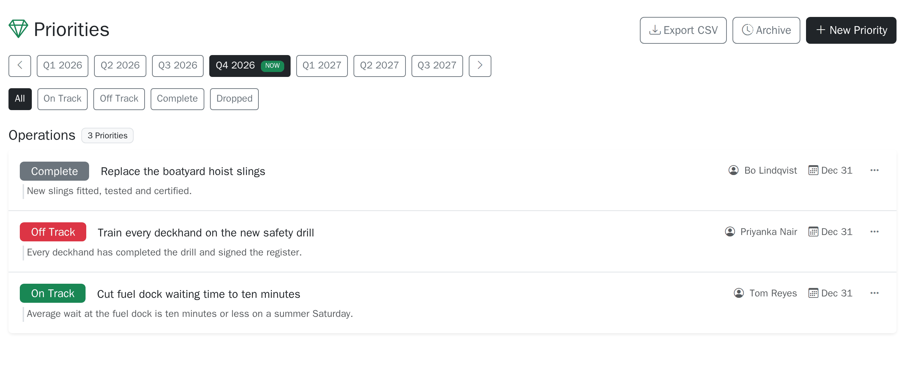
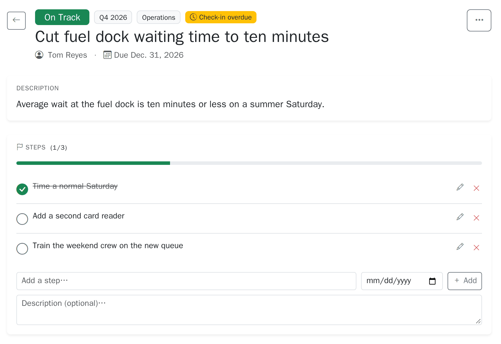
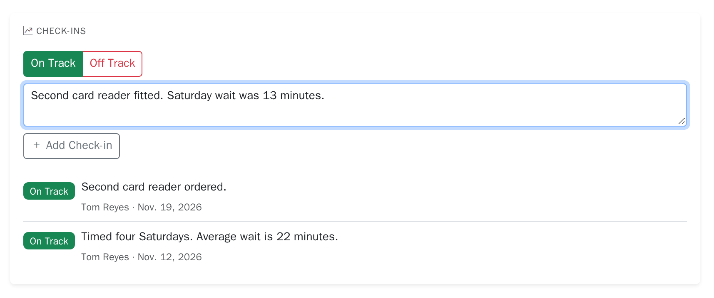
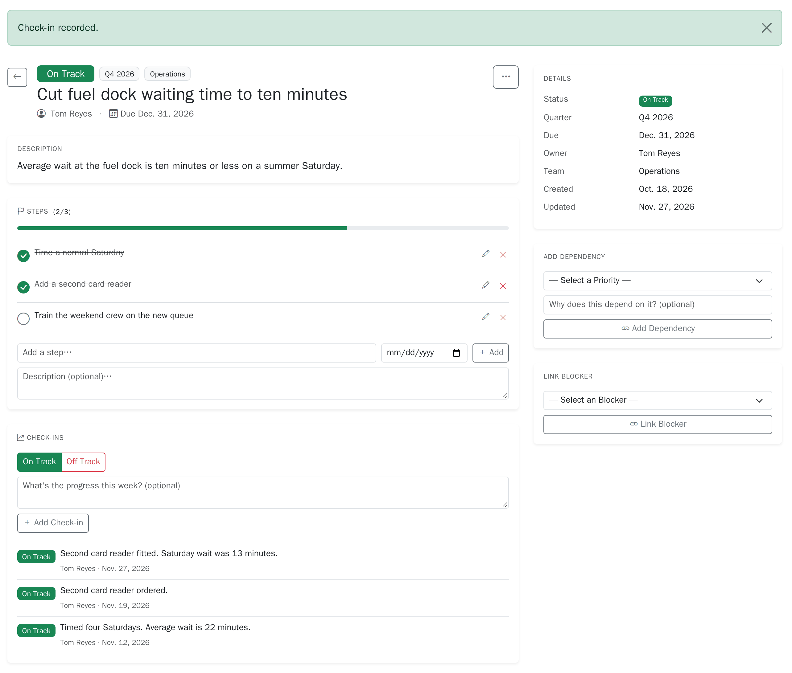
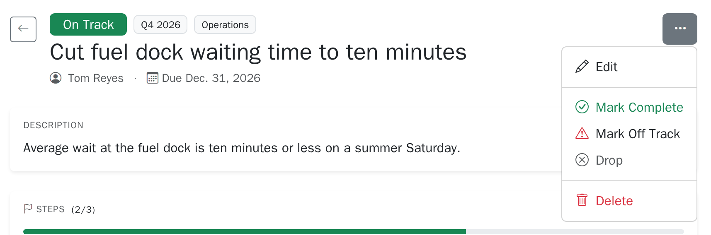

# Check in on a Priority

A check-in is a short weekly note from the owner of a Priority. It says whether the Priority is on track and what has moved.

Your organisation may have renamed some words. This page uses the default names. See the [glossary](../reference/glossary.md).

## Before you start

- **Role needed:** you must own the Priority, or be an Admin. Other people can read the check-ins but cannot add one.
- The Priority must be **On Track** or **Off Track**. You cannot check in on a Priority that is **Complete** or **Dropped**.

## Record this week's progress

1. In the navigation bar, select **Priorities**, then **Quarterly Priorities**. The address is `/rocks/`.

   You see the Priorities for the team named in the navigation bar.

   

2. Select the title of the Priority.

   You see the Priority page. A yellow **Check-in overdue** label shows if nobody has checked in for 7 days.

   

3. In the **Check-ins** card, select **On Track** or **Off Track**.

4. Optional: type a note about this week's progress.

   

5. Select **Add Check-in**.

   A green message says **Check-in recorded.** The new check-in is at the top of the list, with your name and the date.

   

:::{important}
A check-in does not change the status of the Priority. If you check in as **Off Track**, also change the status. The next section shows how.
:::

## Change the status

1. On the Priority page, select the three dots at the top right.

   A menu opens.

   

2. Select one of these:

   | Menu item | What it does |
   |---|---|
   | **Mark Off Track** | Sets the status to **Off Track** |
   | **Mark On Track** | Sets the status back to **On Track**. You see this item when the Priority is off track |
   | **Mark Complete** | Sets the status to **Complete** |
   | **Drop** | Sets the status to **Dropped** |

   The page reloads and the label at the top shows the new status.

## What happens next

- When a Priority changes to **Off Track**, its owner gets an email, unless they have turned that email off or email is not set up.
- The **Check-in overdue** label goes away for 7 days after a check-in.
- The Dashboard counts Priorities that are **Off Track**.
- A Priority that is **Complete** or **Dropped** no longer appears in the Weekly Meeting. It stays on the **Priorities** page, and under **Archive**.
