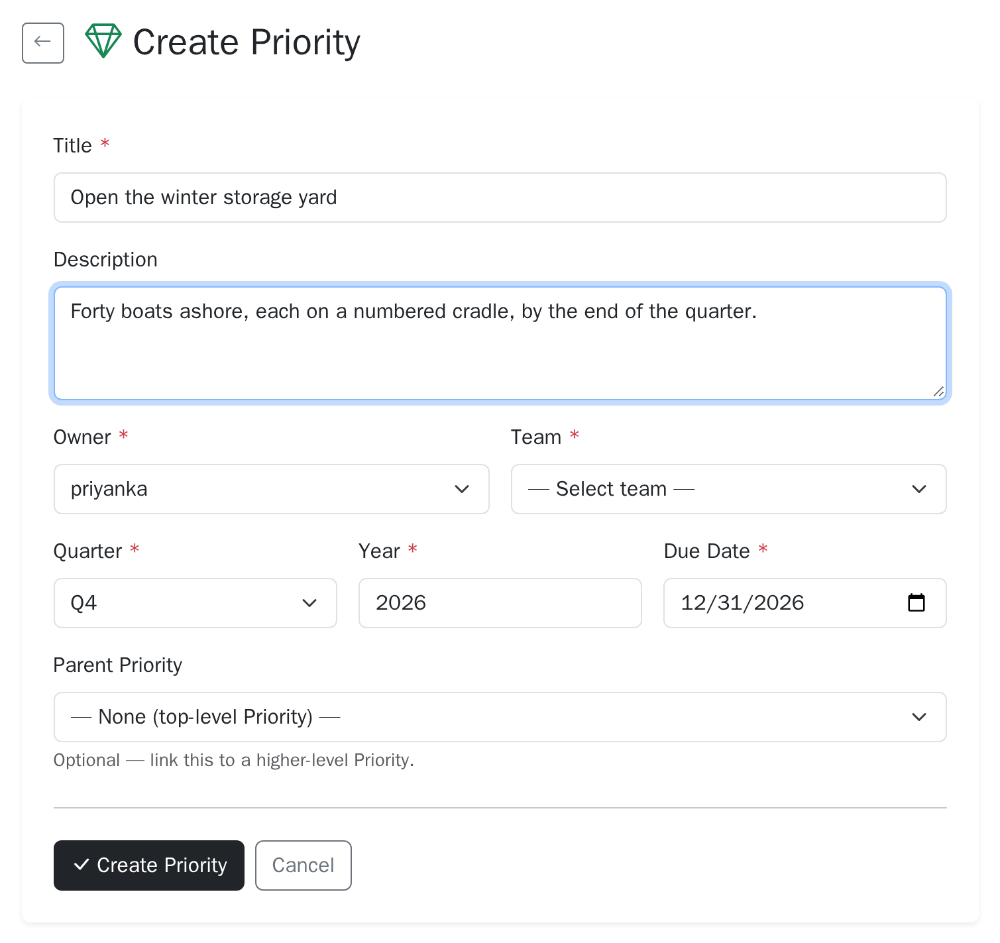
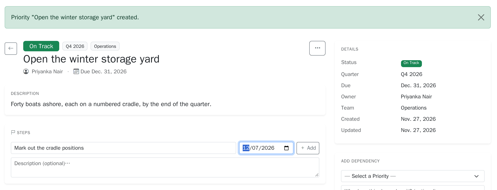
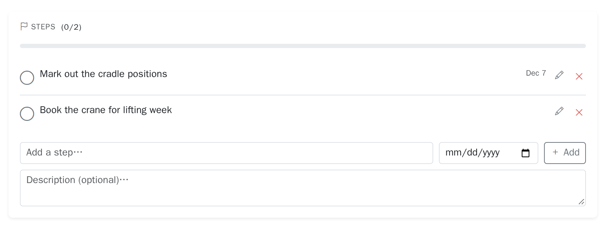
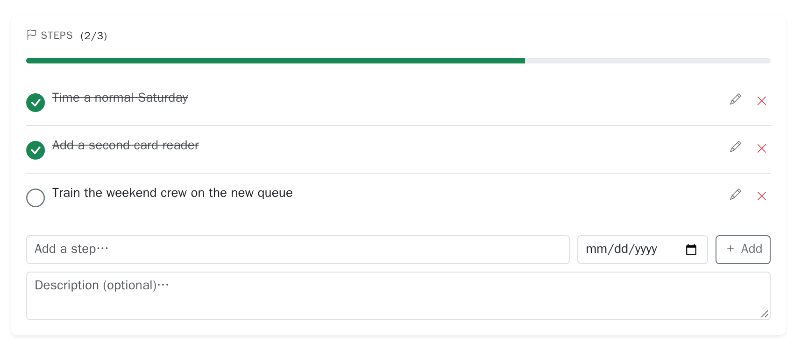

# Create a Priority and add Steps

A Priority is one important result your team has agreed to deliver this quarter. Steps are the smaller stages on the way there.

Your organisation may have renamed some words. This page uses the default names. See the [glossary](../reference/glossary.md).

## Before you start

- **Role needed to create a Priority:** any. You must belong to at least one team.
- **Role needed to add Steps:** you must own the Priority, or be an Admin.
- The navigation bar must show the team the Priority is for.

## Create the Priority

1. In the navigation bar, select **Priorities**, then **New Priority**. The address is `/rocks/new/`.

   You see the **Create Priority** form.

2. In **Title**, type the result you want. Keep it short.

3. In **Description**, say what "done" looks like. Make it something you can measure.

4. In **Owner**, choose the one person who answers for this Priority. The list shows the usernames of people in the team.

5. Leave **Team** empty. The Priority is saved to the team named in the navigation bar.

6. Check **Quarter**, **Year** and **Due Date**. They start on the current quarter and its last day.

7. Optional: choose a **Parent Priority** if this one supports a bigger Priority in the same team.

   

8. Select **Create Priority**.

   You see the new Priority's page. A green message confirms it was created. Its status starts as **On Track**.

:::{note}
Admins see one more tick box, **Company-wide Priority**. Ticking it shows the Priority on the Vision and Delivery Board as well as on the team's list.
:::

## Add Steps

1. On the Priority page, find the **Steps** card.

2. In the box that says **Add a step…**, type the first Step.

3. Optional: choose a date for the Step in the date box next to it.

   

4. Select **Add**.

   A green message says **Step added.** The Step appears in the list with an empty circle.

5. Repeat for each Step.

   

To change a Step, select the pencil icon next to it. To remove it, select the cross.

## Tick off a Step

1. Select the circle to the left of the Step.

   The circle turns into a green tick, the Step is struck through, and the progress bar grows.

   

To untick a Step, select the green tick.

## What happens next

- The Priority appears on the **Priorities** page for its quarter, at `/rocks/`.
- It appears in the **Priority Review** part of the team's Weekly Meeting while it is **On Track** or **Off Track** in the current quarter.
- The owner should now [check in on the Priority](check-in-on-a-priority.md) every week.
