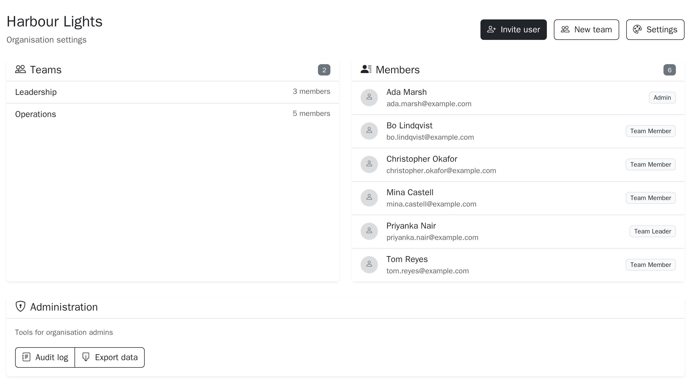
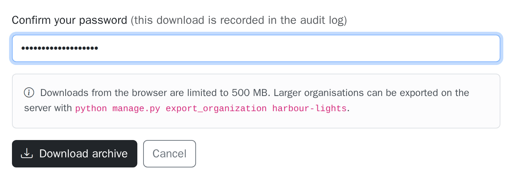
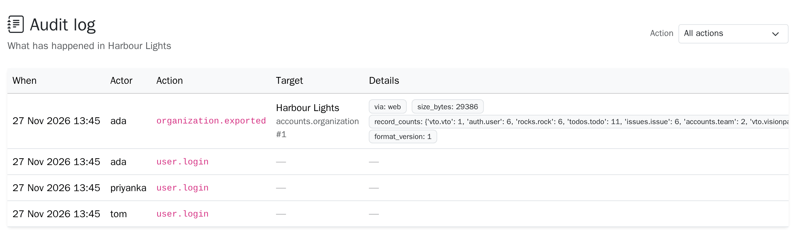

# Export your organisation's data

You can download a copy of everything that belongs to your organisation. Use it as a backup you hold yourself, to open the records in a spreadsheet, or to move to another Empresadence.

## Before you start

- **Role needed:** Admin.
- You need your own password. The page asks for it again.
- The download holds names and email addresses. Decide where to keep it before you start.

## Download the archive

1. Select your name at the top right of the page, then **Organisation**. The address is `/org/`.

   You see your organisation's teams and members. At the bottom is an **Administration** card.

   

2. Select **Export data**. The address is `/org/export/`.

   You see what the archive contains and how many records of each kind it holds.

3. Type your password in **Your password**.

   

4. Select **Download archive**.

   Your browser downloads one zip file. Its name starts with `empresadence-export-`, followed by your organisation's short name and the date.

## What is in the archive

| Item | What it holds |
|---|---|
| `README.txt` | A description of the archive |
| `manifest.json` | What was exported, when, by whom, and the record counts |
| `data/` | One JSON file for each kind of record. Another Empresadence can import these |
| `csv/` | The same records as CSV files, for spreadsheets |
| `media/` | Your organisation's logo and members' profile pictures |

Member accounts are included with their name, email address, username and activity dates only. Passwords are never included.

## What happens next

- The export is written to your organisation's audit log, with its size and record counts. To see it, select **Audit log** on the **Organisation** page.

  

- If the archive would be larger than the limit for browser downloads, you see a message naming the limit. Ask the person who hosts your Empresadence to run the export for you. See [Management commands](../reference/management-commands.md).
- To load the archive into another Empresadence, the person who hosts it runs the `import_organization` command.
