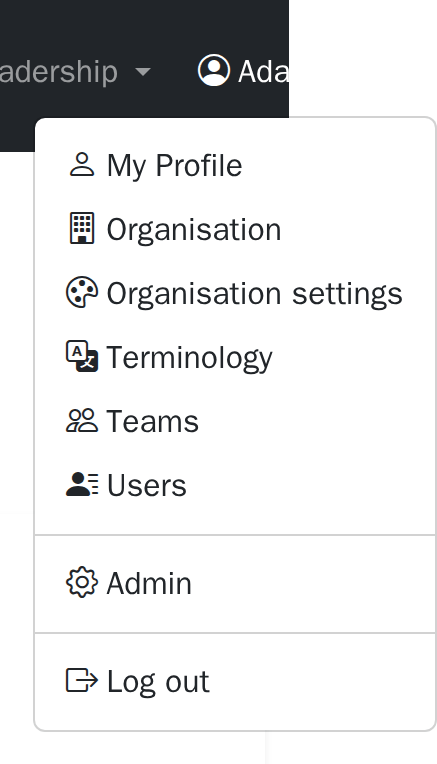
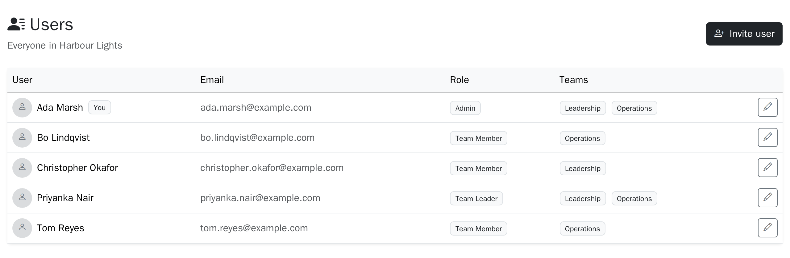
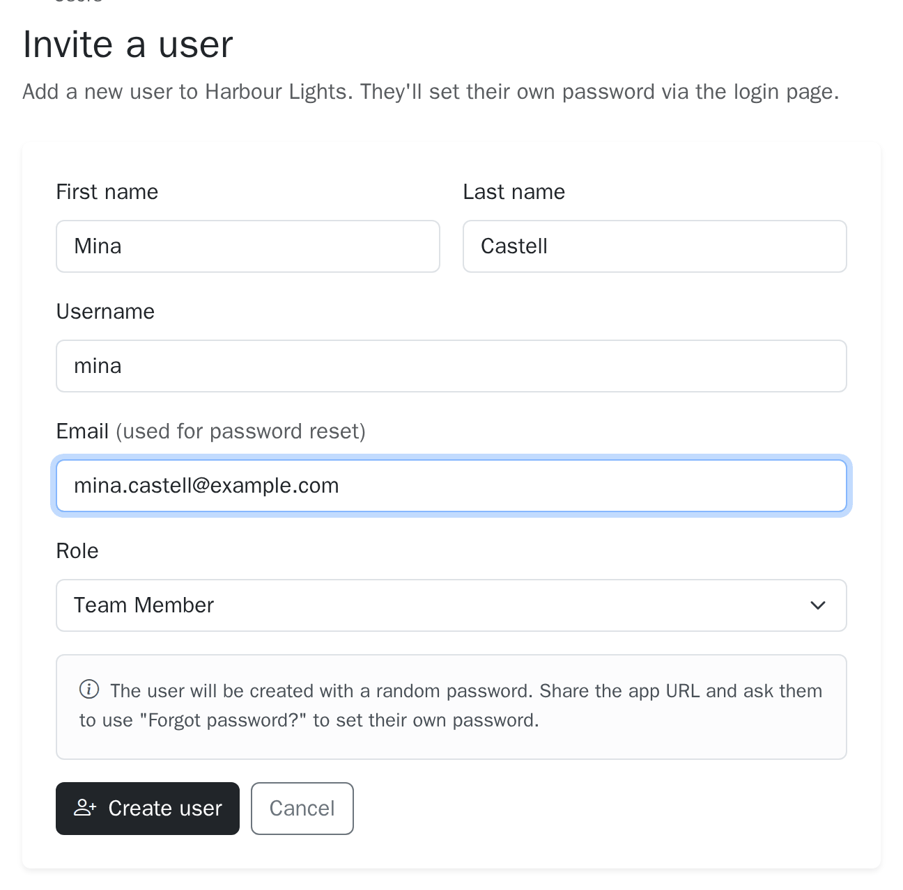
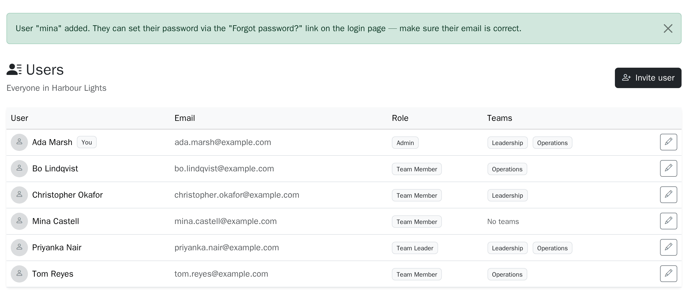
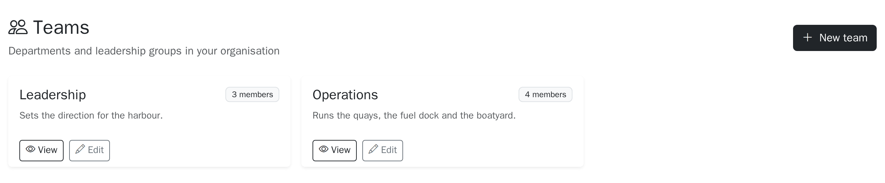
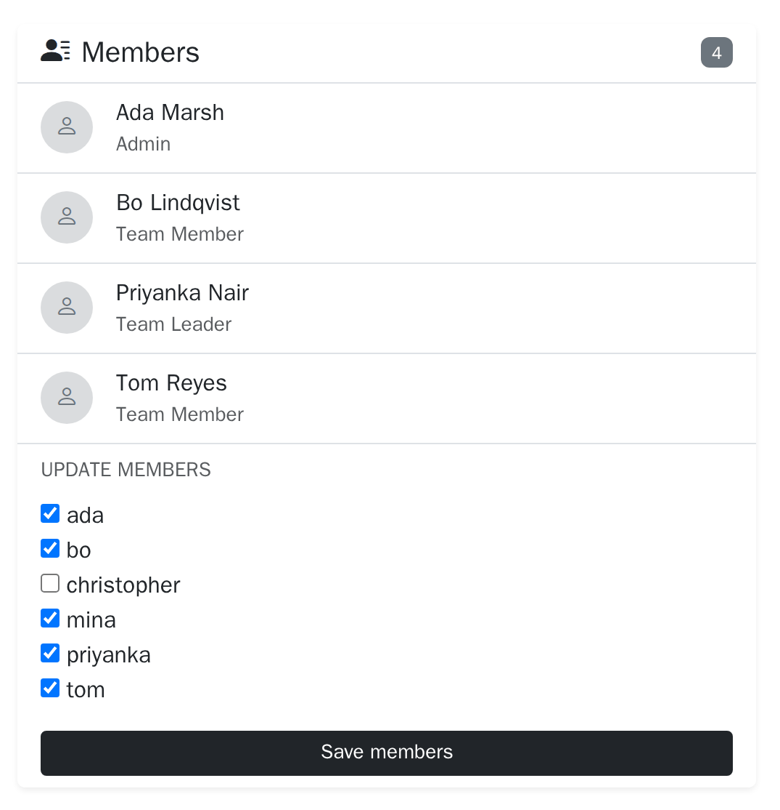

# Invite a person and set their role

Inviting a person creates their account, gives them a role in your organisation, and emails them a link to set a password.

Your organisation may have renamed some words. This page uses the default names. See the [glossary](../reference/glossary.md).

## Before you start

- **Role needed:** Admin.
- You need the person's email address.
- Decide their role. See [Roles and what each can do](../reference/roles.md).

## Invite the person

1. Select your name at the top right of the page, then **Users**. The address is `/users/`.

   

   You see everyone in your organisation, with their email address, role and teams.

   

2. Select **Invite user**. The address is `/users/invite/`.

   You see the **Invite a user** form.

3. Type the person's **First name** and **Last name**.

4. Type a **Username**. They sign in with it. It must be different from every other username on this Empresadence.

5. Type their **Email**. Check it. The link to set a password goes to this address.

6. In **Role**, choose **Admin**, **Team Leader** or **Team Member**.

   

7. Select **Create user**.

   You see the **Users** page again. A green message confirms the person was added, and they are in the list.

   

## Add the person to a team

A new person is not in any team. Until they are, they see no Priorities, Actions or Blockers.

1. Select your name at the top right of the page, then **Teams**. The address is `/teams/`.

   

2. Select **View** on the team.

3. Under **Update members**, tick the person's username.

   

4. Select **Save members**.

   A green message says **Team members updated.** The person is now in the **Members** list.

To remove someone from a team, untick their username and select **Save members**.

## What happens next

- The person gets an email with a link to set their password. The link stops working after a few days.
- If the email does not arrive, or the link has run out, ask them to open the sign-in page and select **Forgot password?**.
- If email is not set up on your Empresadence, no email is sent. Ask the person to use **Forgot password?** once it is, or ask the person who hosts your Empresadence to set a password for them.

## Change what a person can do later

The **Users** page shows each person's role but has no button to change it.
A person with access to the site administration at `/admin/` can change it there, under **Memberships**. See [Roles and what each can do](../reference/roles.md).
