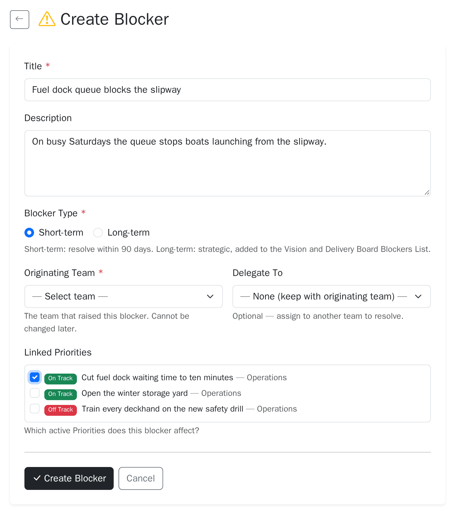
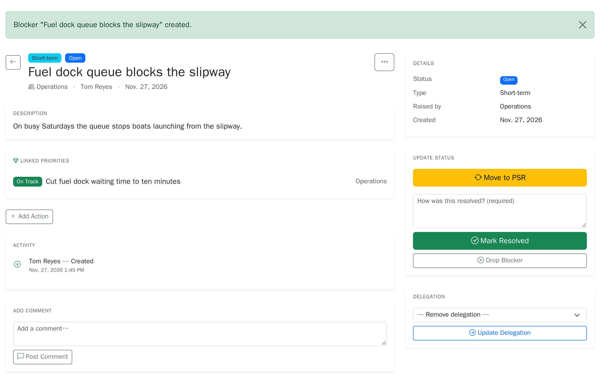
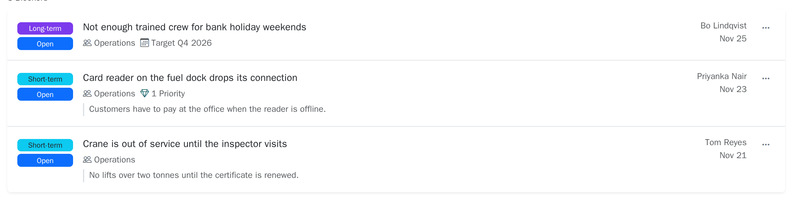
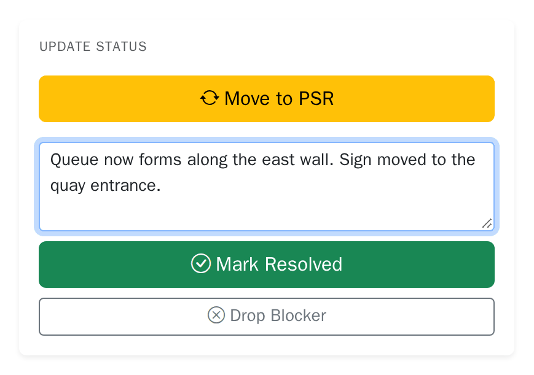
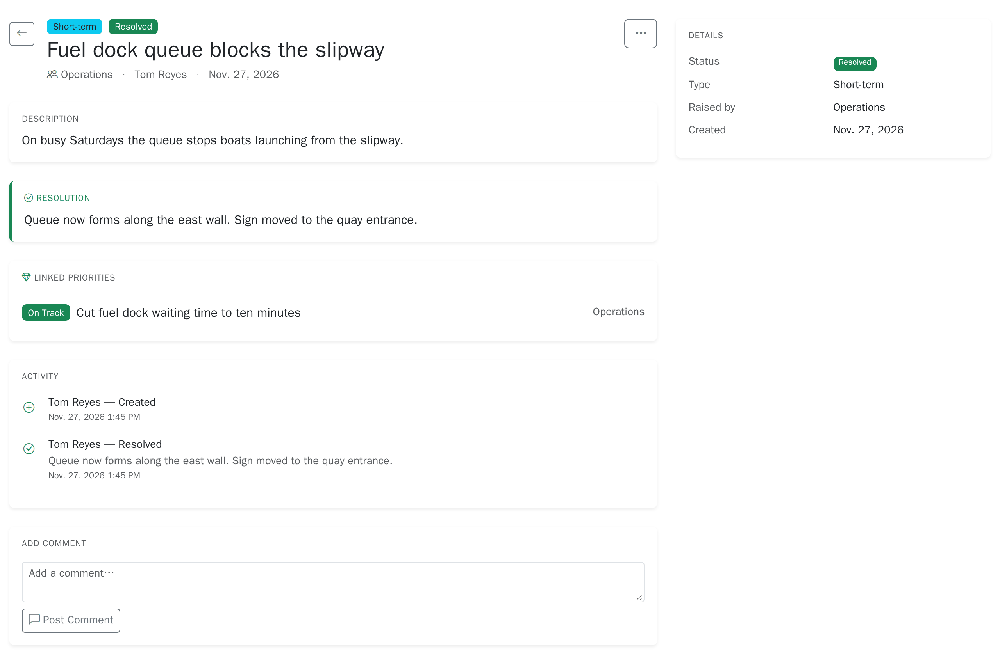

# Raise and resolve a Blocker

A Blocker is a problem, obstacle or open question that is slowing your team down.
You raise it so the team can deal with it in the PSR part of the Weekly Meeting. PSR stands for Problem, Solve, Resolve.

Your organisation may have renamed some words. This page uses the default names. See the [glossary](../reference/glossary.md).

## Before you start

- **Role needed to raise a Blocker:** any. You must belong to at least one team.
- **Role needed to resolve a Blocker:** you must be in the team that raised it, or be an Admin.
- The navigation bar must show the team the Blocker belongs to.

## Raise a Blocker

1. In the navigation bar, select **Blockers**, then **New Blocker**. The address is `/issues/new/`.

   You see the **Create Blocker** form.

2. In **Title**, name the problem in a few words.

3. Optional: in **Description**, say what is going wrong and who it affects.

4. Under **Blocker Type**, choose one:

   | Type | Use it when |
   |---|---|
   | **Short-term** | The team can solve it within about 90 days |
   | **Long-term** | It is a bigger question for a later quarter. You must then choose a **Target Quarter** and a **Target Year** |

5. Leave **Originating Team** empty. The Blocker is saved to the team named in the navigation bar.

6. Optional: under **Linked Priorities**, tick any Priority this Blocker affects.

   

7. Select **Create Blocker**.

   You see the new Blocker's page. A green message confirms it was created. The right side has the **Update Status** buttons.

   

## Find a Blocker

Select **Blockers**, then **Blockers List**. The address is `/issues/`.
You see the open Blockers raised by the team named in the navigation bar.

## Resolve a Blocker

1. Open the Blocker by selecting its title.

2. Optional: select **Move to PSR** to show that the team is now working on it.

3. Under **Update Status**, type how the problem was solved. You cannot resolve a Blocker without this note.

   

4. Select **Mark Resolved**.

   The page reloads. The status reads **Resolved** and your note appears in a **Resolution** card.

   

If the problem no longer matters, select **Drop Blocker** instead.

## What happens next

- An open Blocker appears in the PSR part of your team's next Weekly Meeting.
- A resolved or dropped Blocker leaves the open list. To see it again, select **Resolved** or **Dropped** at the top of the list.
- Every change is added to the **Activity** list on the Blocker page, with who made it and when.
- Anyone who can open the Blocker can add a comment under **Add Comment**.
