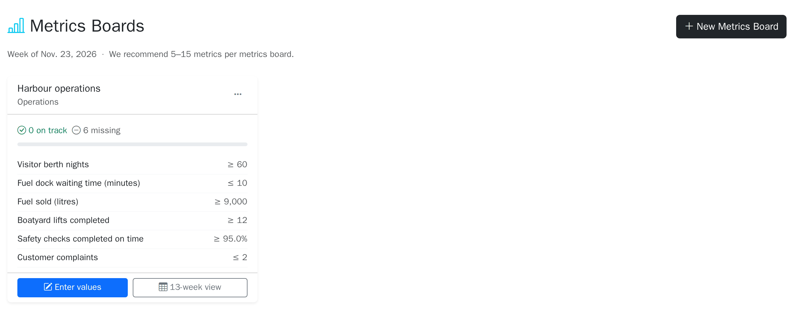
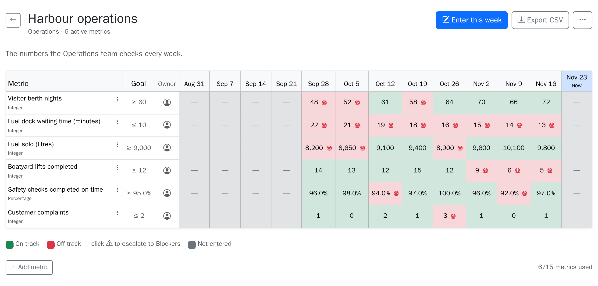
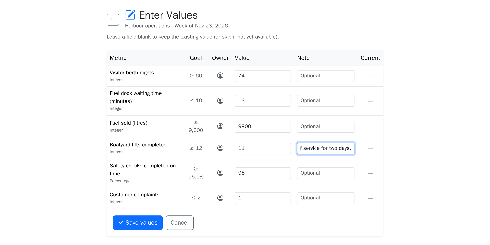
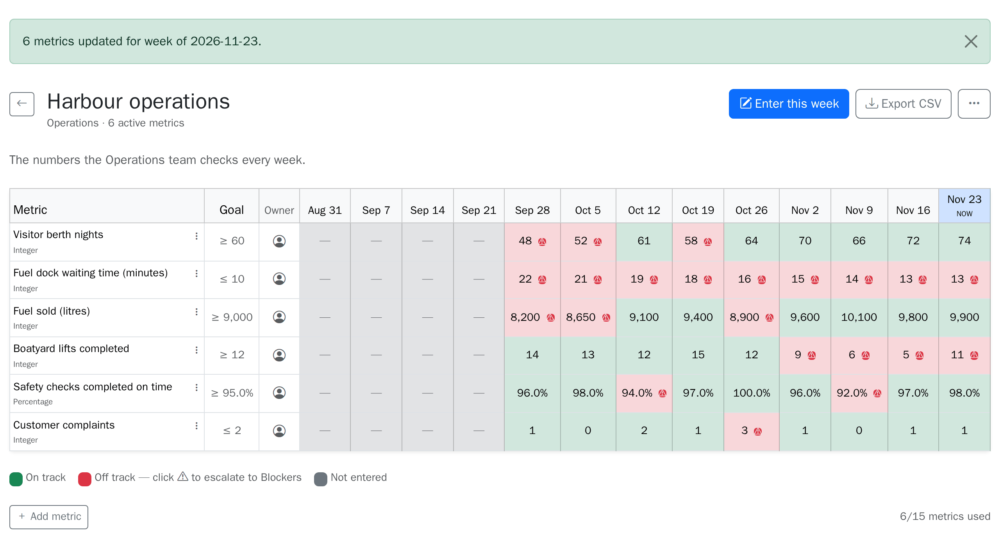

# Record numbers on a Metrics Board

A Metrics Board is a small table of numbers your team checks every week. Each number has a goal.
The board shows the last 13 weeks, so you can spot a trend.

Your organisation may have renamed some words. This page uses the default names. See the [glossary](../reference/glossary.md).

## Before you start

- **Role needed:** any.
- The board must already exist and have metrics. If your team has none, select **New Metrics Board** on the **Metrics Boards** page, then **Add metric** on the board.
- Have this week's numbers ready. A week runs from Monday to Sunday.

## Enter this week's numbers

1. In the navigation bar, select **More**, then **Metrics Boards**. The address is `/scorecards/`.

   You see the boards for the team named in the navigation bar. To see boards for all your teams, select **All teams**.

   

2. Select the name of the board.

   You see a table with one row for each metric and one column for each week. The column for this week is marked **NOW**.

   

3. Select **Enter this week**.

   You see the **Enter Values** page, with one row for each metric.

4. Type a number in **Value** for each metric you have. Leave a row empty to skip it.

5. Optional: type a short **Note** next to any number that needs explaining.

   

6. Select **Save values**.

   You see the board again. A green message says how many metrics were updated. This week's column is now filled in.

   

## Read the colours

| Cell | Meaning |
|---|---|
| Green background | The number met its goal |
| Red background with a warning icon | The number missed its goal |
| Grey background with a dash | No number was entered for that week |

The **Goal** column shows the goal for each metric. `≥ 60` means 60 or more. `≤ 10` means 10 or fewer.

## Correct a number

1. Select **Enter this week** again.
2. Type the right number and select **Save values**.

The new number replaces the old one. You can only enter or change numbers for the current week.

## What happens next

- The board appears in the **Metrics Board Review** part of the team's Weekly Meeting.
- To turn a missed number into a Blocker, select the warning icon in its cell. The Blocker opens with the metric, the number and the goal already written in.
- The Dashboard shows how many numbers were entered this week.
- To download the table, select **Export CSV** on the board.
