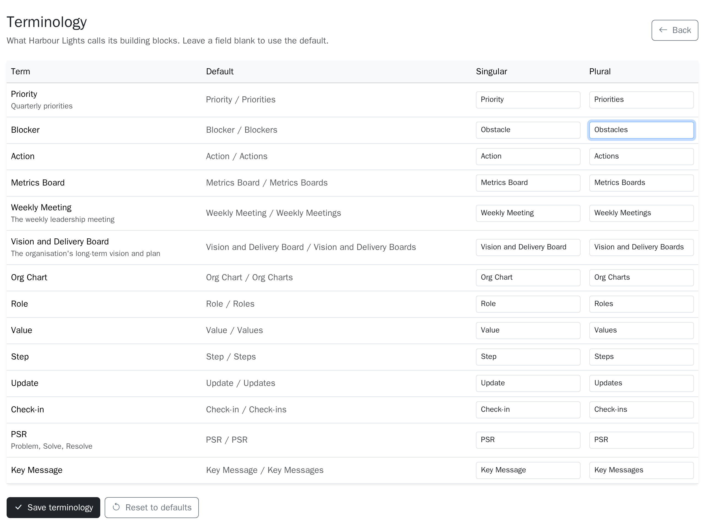
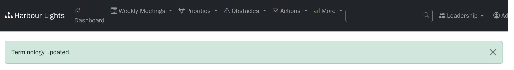

# Rename the vocabulary

Every organisation can choose its own words. If your team says "Goal" and not "Priority", you can make the whole tool say "Goal".

## Before you start

- **Role needed:** Admin.
- Agree the new words with your team first. The change applies to everyone in your organisation at once.

## Rename a word

1. Select your name at the top right of the page, then **Terminology**. The address is `/org/settings/terminology/`.

   You see a table. Each row is one word, with its default, and a box for the singular and the plural.

2. Find the row for the word you want to change.

3. Type your word in **Singular** and in **Plural**. For example, type `Obstacle` and `Obstacles` in the **Blocker** row.

   

4. Select **Save terminology**.

   A green message says **Terminology updated.** The navigation bar, page titles, buttons and emails now use your word.

   

To go back to the default for one word, clear its two boxes and save.

## Go back to all the defaults

1. Select **Reset to defaults**.

   Your browser asks you to confirm.

2. Confirm.

   A green message says **Terminology reset to defaults.**

## Words you can rename

See the [glossary](../reference/glossary.md) for the full list and what each word means.

## What happens next

- Everyone in your organisation sees the new words the next time they load a page.
- Your records do not change. Only the labels do.
- These docs keep using the default words. Tell your team which words you changed.
