# Run a Weekly Meeting

A Weekly Meeting follows the same agenda every week. The tool keeps time, shows the right information for each part, and records what was decided.

Your organisation may have renamed some words. This page uses the default names. See the [glossary](../reference/glossary.md).

## Before you start

- **Role needed:** any. Anyone signed in to your organisation can schedule, start and run a meeting.
- Put the meeting on a shared screen, so the whole team sees the same thing.
- Ask the team to [record this week's numbers](record-numbers-on-a-metrics-board.md) and [check in on their Priorities](check-in-on-a-priority.md) before the meeting.

## The default agenda

| Part | Minutes | What the team does |
|---|---|---|
| Check-in | 5 | Each person shares one personal best and one business best |
| Metrics Board Review | 5 | Look at the team's metrics and their goals |
| Priority Review | 5 | Each owner says whether their Priority is on track |
| Updates | 5 | Share short good news and concerns |
| Action Review | 5 | Go through open Actions and mark the finished ones |
| PSR | 60 | Work through the open Blockers |
| Conclude | 5 | Agree Key Messages, rate the meeting, and finish |

The whole meeting takes 90 minutes. Your organisation may use a different agenda.

## Schedule the meeting

1. Open `/meetings/create/`. Or select **Weekly Meetings** in the navigation bar, then **Weekly Meeting**, then **Schedule Weekly Meeting**.

   You see the **Schedule Weekly Meeting** form.

2. In **Team**, choose the team that is meeting.

3. In **Date**, choose the day of the meeting.

   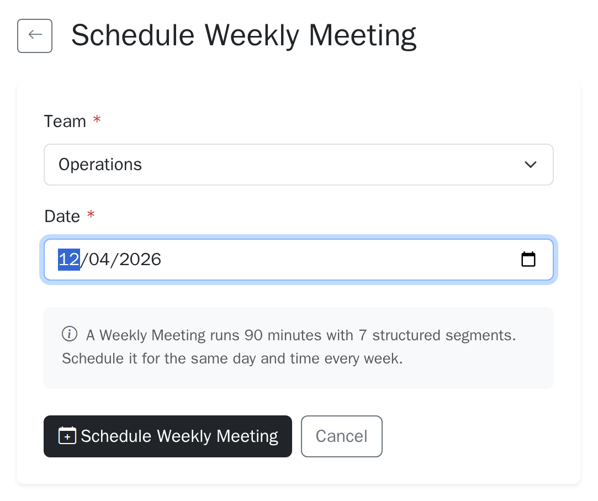

4. Select **Schedule Weekly Meeting**.

   You see the meeting page. It says **Ready to start** and lists the agenda.

   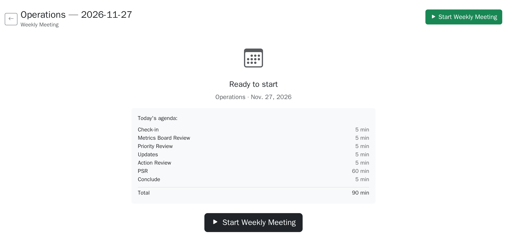

To find the meeting later, open **Weekly Meetings**. The list shows the meetings of the team named in the navigation bar.

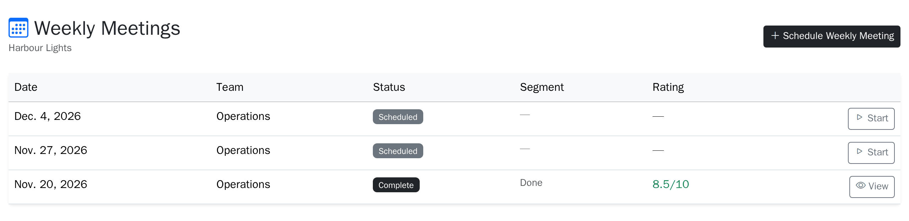

## Start the meeting

1. On the meeting page, select **Start Weekly Meeting**.

   The meeting is now **Live**. On the left you see a timer for the current part and the full agenda. On the right you see the first part, **Check-in**.

2. Ask everyone else to open **Weekly Meetings** on their own device and select **Run** next to the meeting.

## Move through the agenda

Each part works the same way:

- The timer on the left counts down the minutes for the part. **Pause** stops it. **Reset** starts it again.
- A notes box sits under each part. Type decisions there and select **Save Notes**.
- When the team is ready, select the **Next** button at the bottom right. It names the part that follows.

:::{important}
You cannot go back to an earlier part. Save your notes before you select **Next**.
:::

1. **Check-in.** Each person types a **Personal Best** and a **Business Best** on their own device and selects **Save**.

   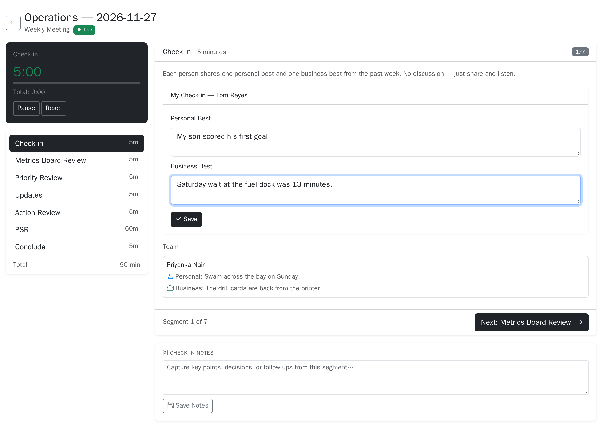

2. Select **Next: Metrics Board Review**.

   You see each metric on the team's Metrics Boards, with its goal.

   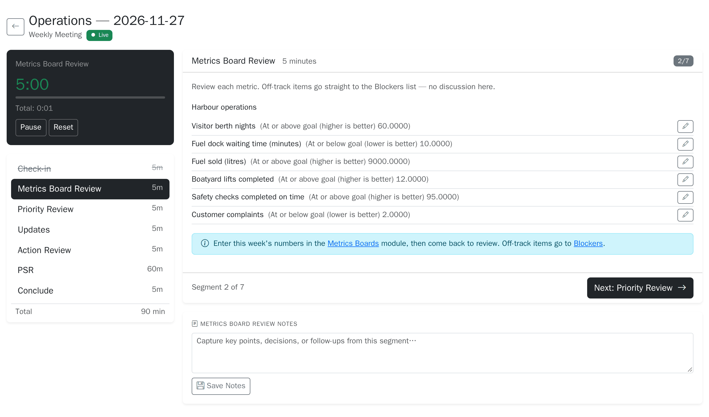

3. Select **Next: Priority Review**.

   You see the team's Priorities for the current quarter that are **On Track** or **Off Track**. Each owner says which it is.

   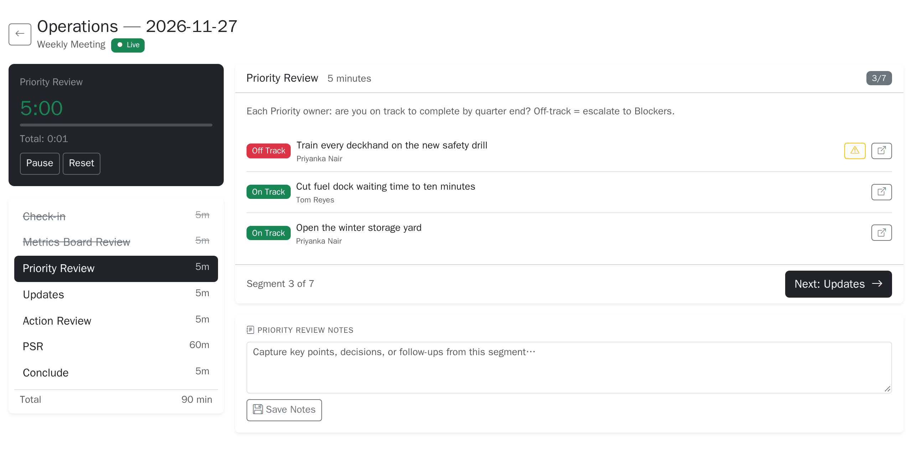

4. Select **Next: Updates**.

   To add an update, choose **Good News** or **Concern / Bad News**, type one line and select **Add**. Anyone in the meeting can add one from their own device.

   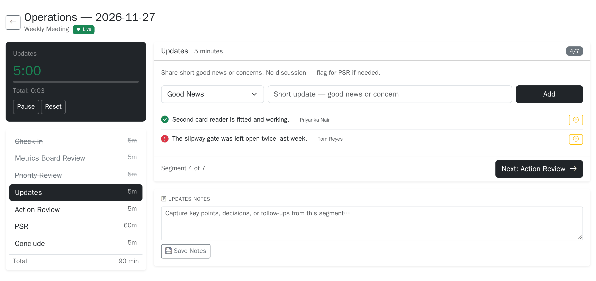

5. Select **Next: Action Review**.

   You see the open Actions owned by people in the team. Select the tick next to an Action to mark it complete.

   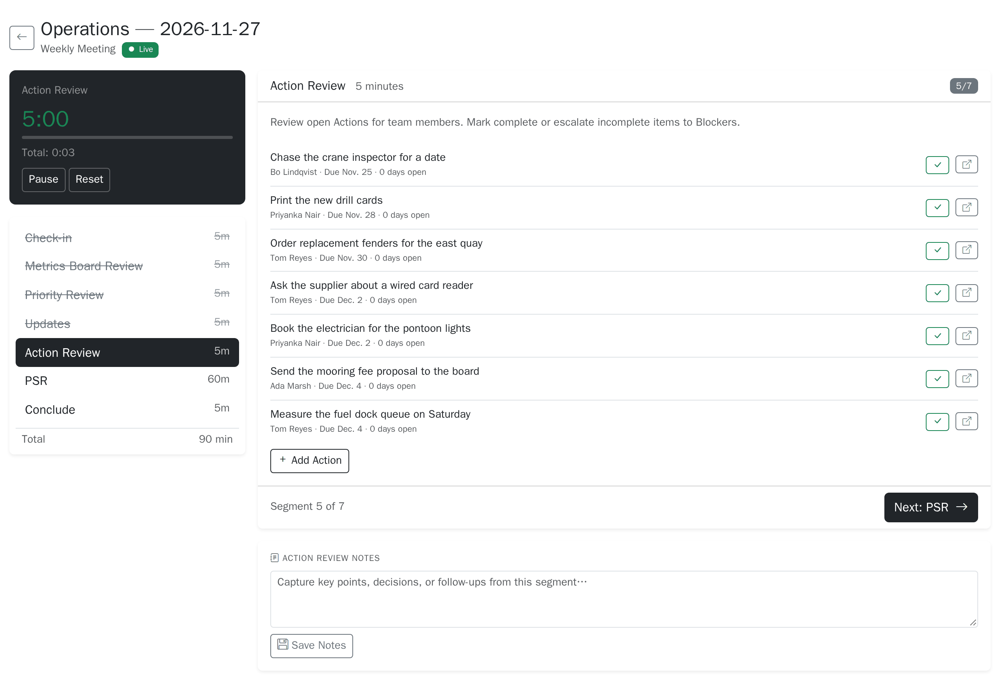

6. Select **Next: PSR**.

   You see the team's open Blockers. This is the longest part of the meeting. Take one Blocker at a time.

   - To create an Action for a Blocker, select the tick-box icon next to it. Fill in the form and select **Create Action**. You return to the meeting.
   - To resolve a Blocker, select the arrow icon next to it. This opens the Blocker page. See [Raise and resolve a Blocker](raise-and-resolve-a-blocker.md).

   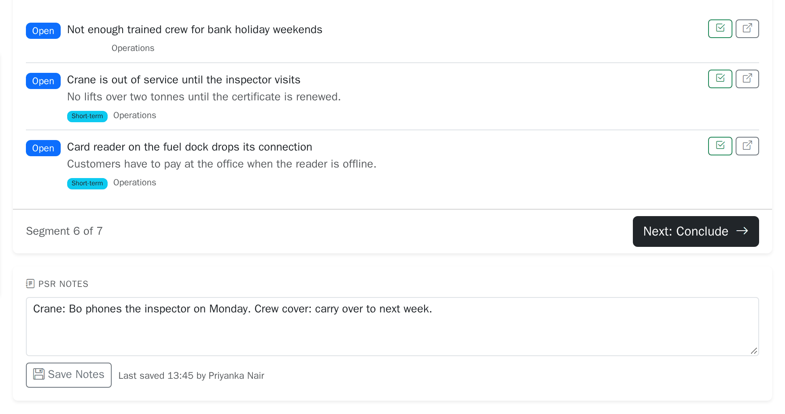

7. Select **Next: Conclude**.

## Conclude the meeting

1. Ask each person to type a **Score (1–10)** on their own device and select **Submit Rating**.

   The scores appear under **Ratings so far**, with the average.

2. Check the list under **Actions Created This Meeting**. Everyone should know which Actions are theirs.

3. In the **Key Messages** box, type what the rest of the organisation needs to know.

   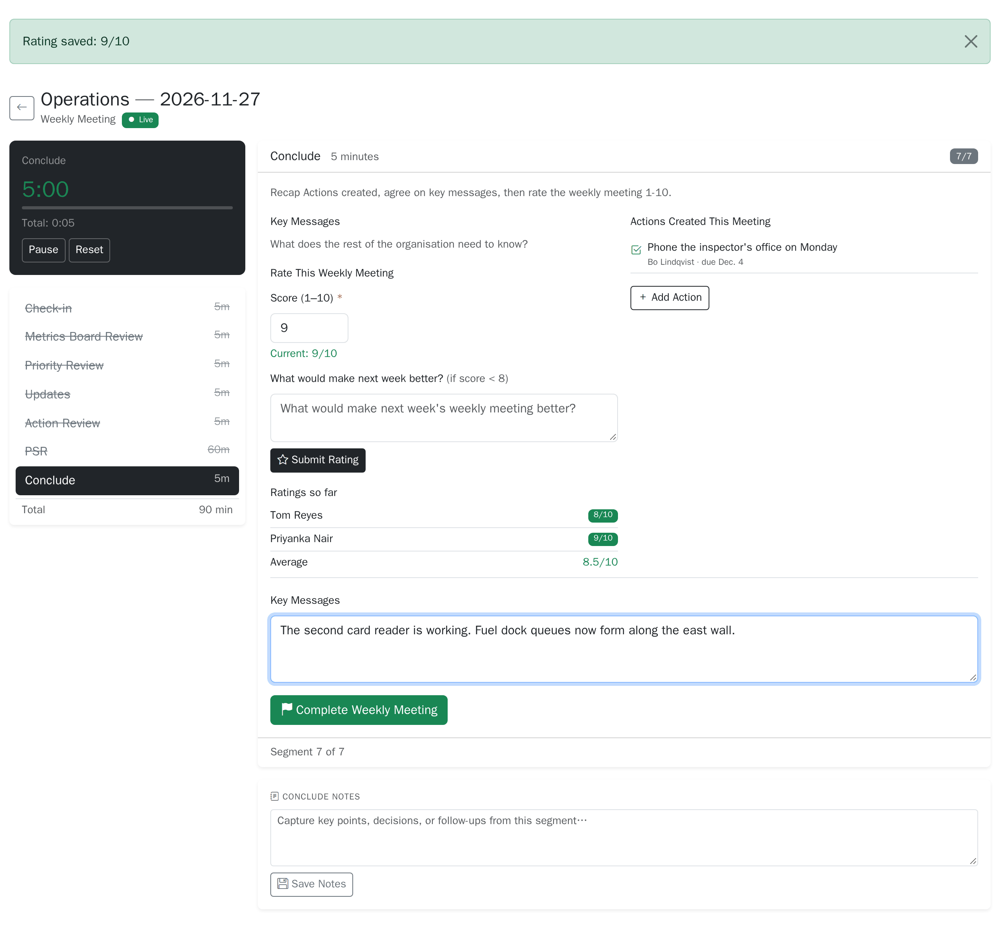

4. Select **Complete Weekly Meeting**.

   Your browser asks you to confirm. You cannot undo this.

5. Confirm.

   You see the summary of the meeting: the average rating, how long it took, the notes, the Key Messages, the Actions created and the check-ins.

   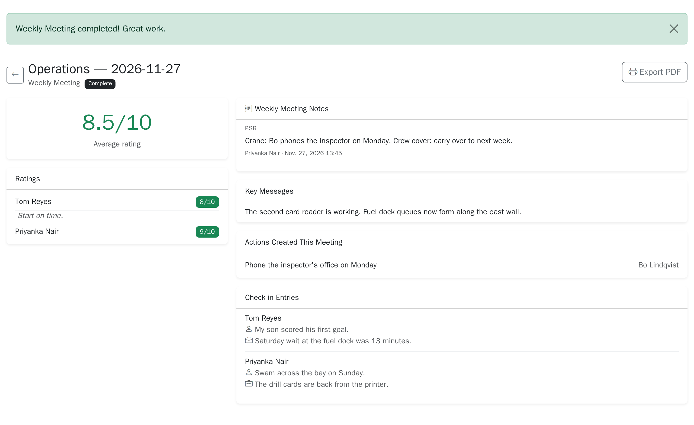

## What happens next

- The meeting shows as **Complete** in the **Weekly Meetings** list, with its average rating. Select **View** to read the summary again.
- To print the summary or save it as a PDF, select **Export PDF** on the meeting page. A print view opens in a new tab.
- The Actions created in the meeting are on each owner's **Actions** page.
- If the person who hosts your Empresadence has set up daily emails, team members get a reminder on the morning of a scheduled meeting.
