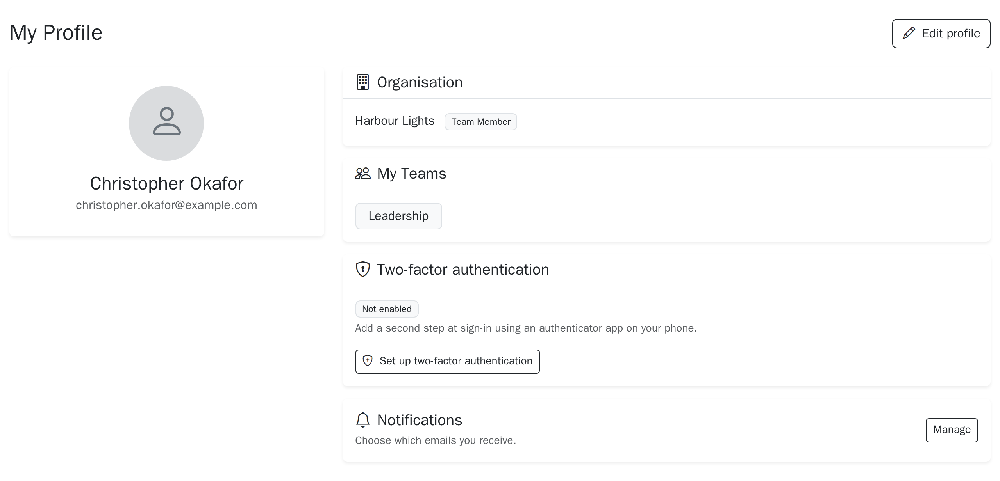
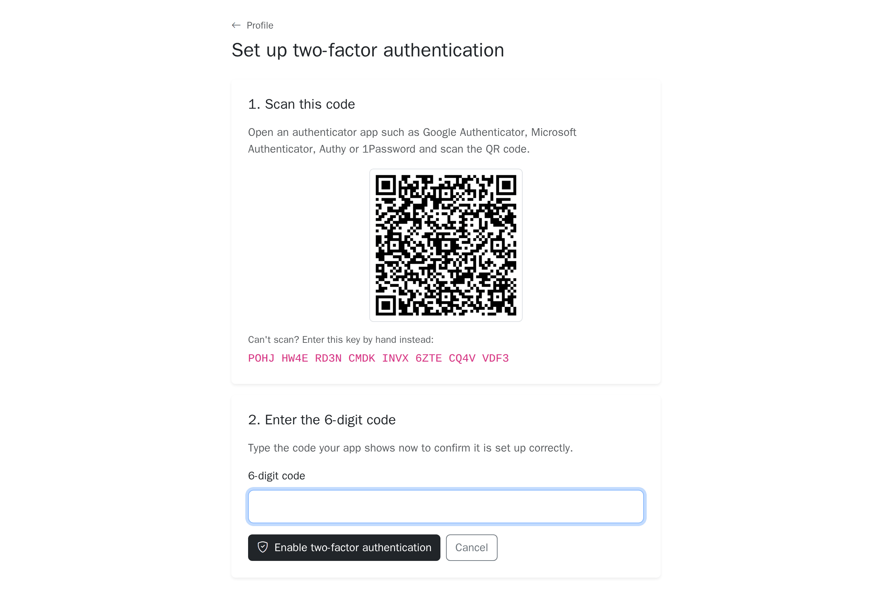
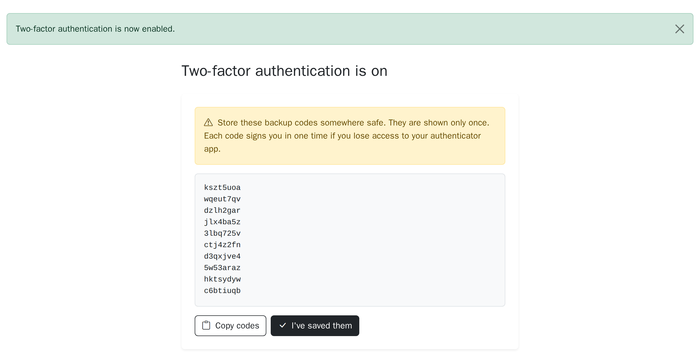
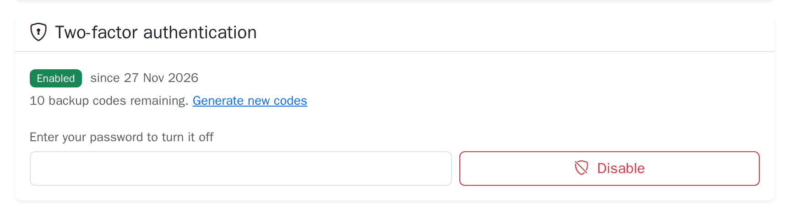
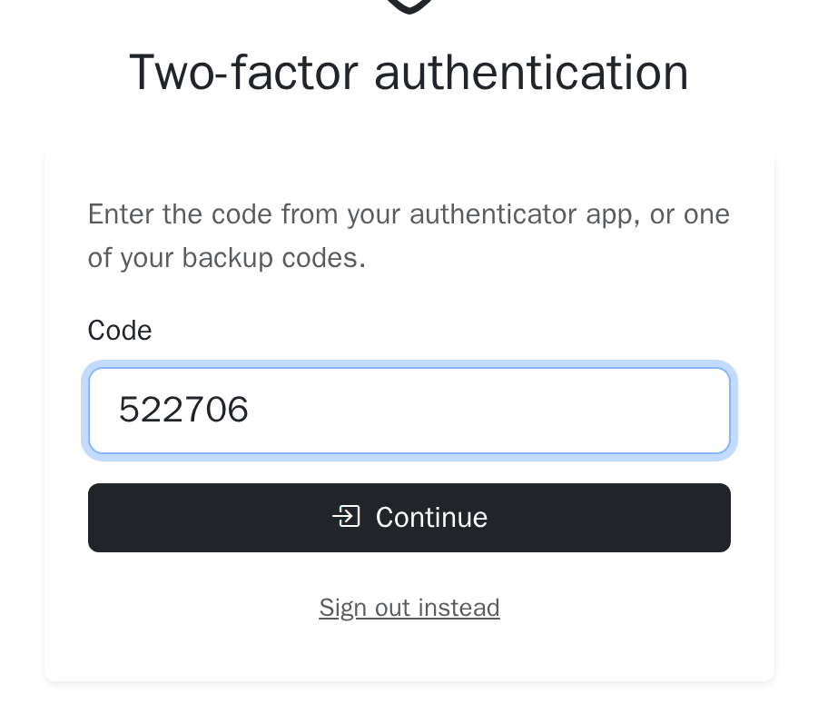

# Turn on two-step sign-in

Two-step sign-in asks for a 6-digit code from your phone after your password. Someone who learns your password still cannot get in.
On screen, Empresadence calls this **Two-factor authentication**.

## Before you start

- **Role needed:** any. You turn this on for your own account only.
- Install an authenticator app on your phone. Examples are Google Authenticator, Microsoft Authenticator, Authy and 1Password.
- Have somewhere safe to keep ten backup codes, such as a password manager.

## Turn it on

1. Select your name at the top right of the page, then **My Profile**. The address is `/profile/`.

   You see your profile. The **Two-factor authentication** card says **Not enabled**.

   

2. Select **Set up two-factor authentication**.

   You see a square QR code and a long key made of letters and numbers.

   

3. Open your authenticator app and scan the QR code. If you cannot scan it, type the key into the app instead.

   The app shows a 6-digit code that changes every 30 seconds.

4. Type the code into **6-digit code**.

5. Select **Enable two-factor authentication**.

   You see ten backup codes. They are shown only once.

   

6. Save the codes somewhere safe. **Copy codes** copies all ten.

7. Select **I've saved them**.

   You see your profile again. The card now says **Enabled** and shows how many backup codes you have left.

   

## Sign in with the second step

1. Sign in with your username and password as usual.

   You see the **Two-factor authentication** page.

2. Type the code your authenticator app shows now.

   

3. Select **Continue**.

   You see the Dashboard.

If you do not have your phone, type one of your backup codes instead. Each backup code works once.

After five wrong codes in a row, wait 30 seconds before you try again.

## Get new backup codes

1. Open **My Profile**.
2. In the **Two-factor authentication** card, select **Generate new codes**.
3. Type your password and confirm.

You see ten new codes. The old ones stop working.

## Turn it off

1. Open **My Profile**.
2. In the **Two-factor authentication** card, type your password in **Enter your password to turn it off**.
3. Select **Disable**.

A green message says **Two-factor authentication is disabled.**

## What happens next

- Every time you sign in, you are asked for a code after your password.
- If you lose your phone and your backup codes, ask the person who hosts your Empresadence to help. An organisation Admin cannot reset this from inside the app.
