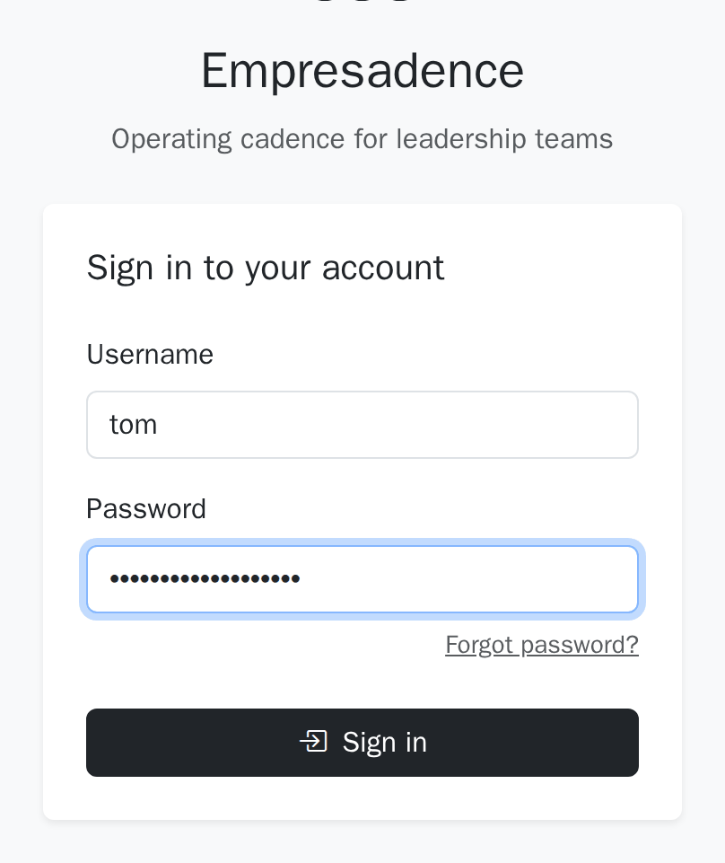
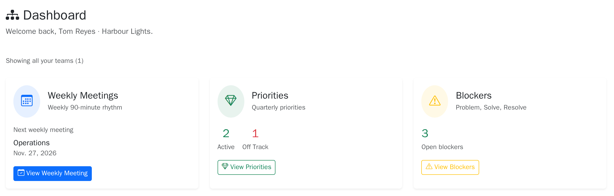
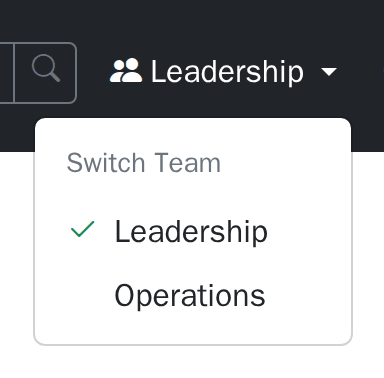
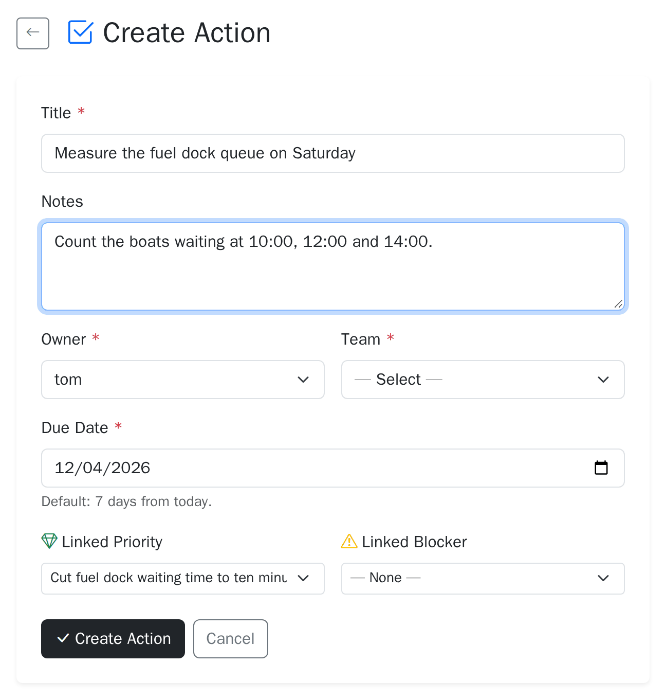
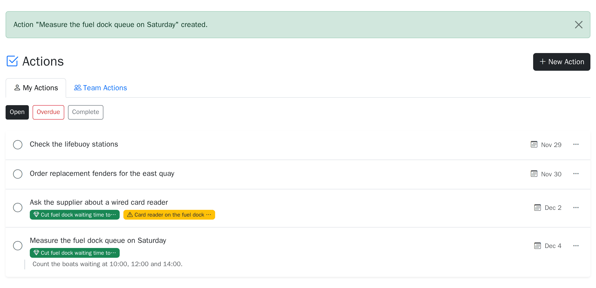
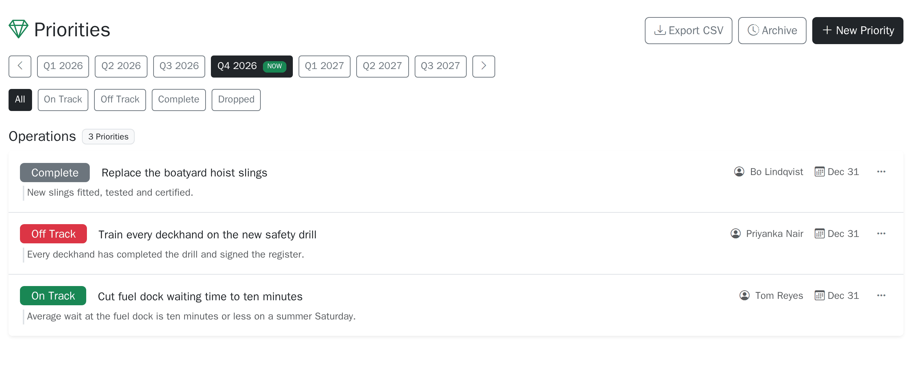
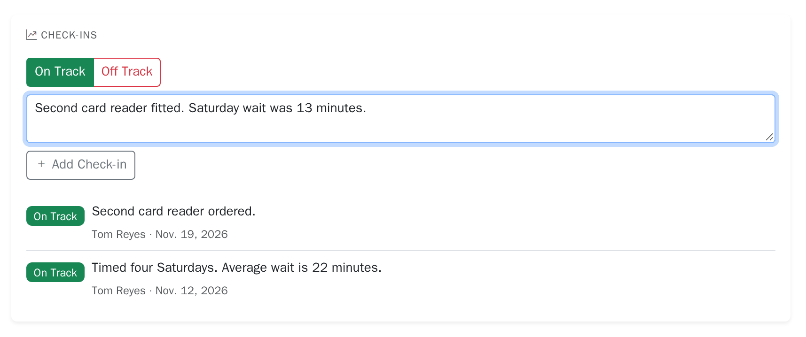
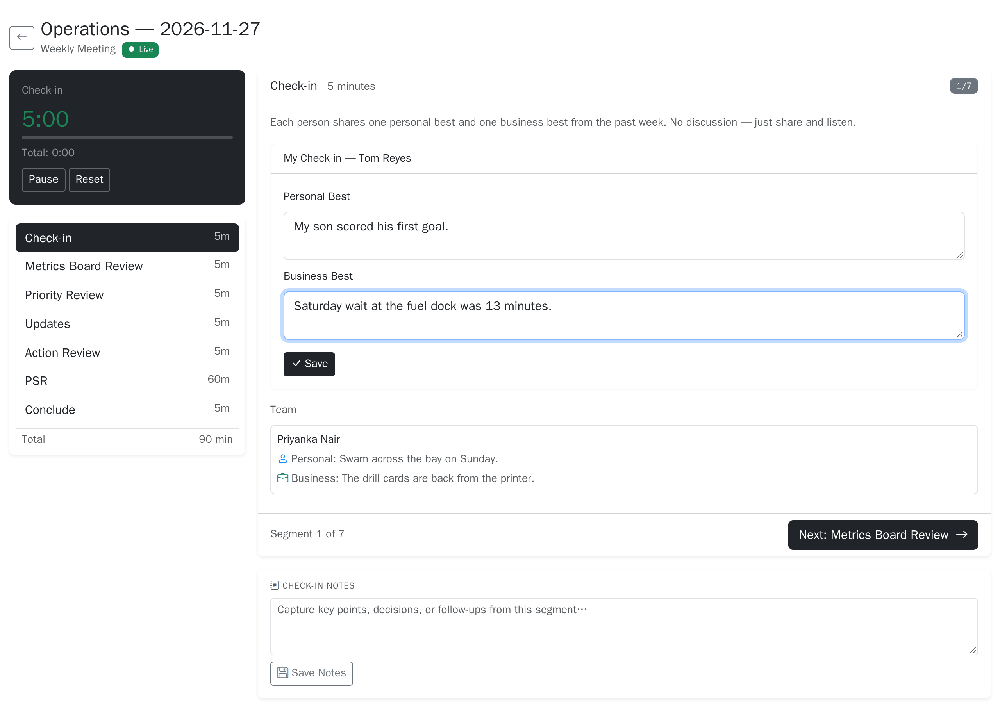

# Your first week

This tutorial walks you through the five things most people do in their first week.
It takes about 20 minutes.

The pictures show a made-up harbour business called Harbour Lights. Your screen shows your own organisation.

Your organisation may have renamed some words. This page uses the default names. See the [glossary](../reference/glossary.md).

## Before you start

You need:

- the web address of your organisation's Empresadence
- a username and a password

If you have been invited but have no password yet, open the sign-in page and select **Forgot password?**. Enter your email address and follow the link you receive.

## Sign in

1. Open your organisation's Empresadence address in a web browser.

   You see the sign-in page.

2. Type your **Username** and **Password**.

   

3. Select **Sign in**.

   You see the **Dashboard**. It shows a card for each part of the tool, with counts for your teams.

   

## Find your team

Almost everything you see belongs to one team at a time. The navigation bar at the top names that team.

1. Look at the top right of the page. The team name is next to the icon of two people.

2. Select the team name.

   A menu opens. Under **Switch Team** you see every team you belong to. A tick marks the team you are looking at.

   

3. If you belong to more than one team, select the team you want.

   The page reloads and the navigation bar shows the new team name.

If the menu says **You are not in any team here yet.**, ask an Admin to add you to a team.

## Add an Action

An Action is a small task for one person to finish within about a week.

1. In the navigation bar, select **Actions**, then **New Action**.

   You see the **Create Action** form.

2. In **Title**, type the task. For example, `Measure the fuel dock queue on Saturday`.

3. Leave **Owner** as it is. It already shows your username.

4. Leave **Team** empty. The Action is saved to the team named in the navigation bar.

5. Check the **Due Date**. It starts at 7 days from today.

   

6. Select **Create Action**.

   You see the **Actions** page. A green message confirms the Action was created, and the Action is in your list.

   

For more detail, see [Add and complete an Action](../how-to/add-and-complete-an-action.md).

## Update a Priority

A Priority is something your team has agreed to finish this quarter. Each Priority has one owner.
The owner checks in every week to say whether it is on track.

1. In the navigation bar, select **Priorities**, then **Quarterly Priorities**.

   You see your team's Priorities for the current quarter.

   

2. Select the title of a Priority you own.

   You see the Priority page, with its **Steps** and **Check-ins**.

3. Under **Check-ins**, select **On Track** or **Off Track**.

4. Type a short note about this week's progress.

   

5. Select **Add Check-in**.

   A green message says **Check-in recorded.** Your note is now at the top of the list.

If you do not own a Priority yet, open one and read it. You only see the check-in box on Priorities you own.

For more detail, see [Check in on a Priority](../how-to/check-in-on-a-priority.md).

## Take part in a Weekly Meeting

Your team meets once a week and works through the same agenda each time. One person runs the meeting on a shared screen.
Everyone else can open the same meeting on their own device and add to it.

1. In the navigation bar, select **Weekly Meetings**, then **Weekly Meeting**.

   You see a list of your team's meetings.

2. Select **Run** next to the meeting that is in progress.

   You see the current part of the agenda. The first part is the **Check-in**.

3. In **Personal Best**, type one good thing from outside work.

4. In **Business Best**, type one good thing from work.

   

5. Select **Save**.

   A green message says **Check-in entry saved.**

6. At the end of the meeting, the person running it moves to **Conclude**. Reload the page, type a **Score (1–10)** and select **Submit Rating**.

   A green message shows your rating.

For the whole meeting from the organiser's side, see [Run a Weekly Meeting](../how-to/run-a-weekly-meeting.md).

## What you have learned

You can now sign in, switch team, add an Action, check in on a Priority and take part in a Weekly Meeting.

Next, read [How the pieces of the weekly rhythm connect](../explanation/weekly-rhythm.md) to see why these parts belong together.
